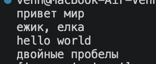
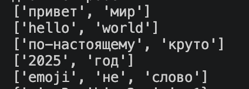
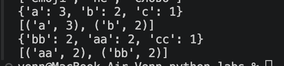
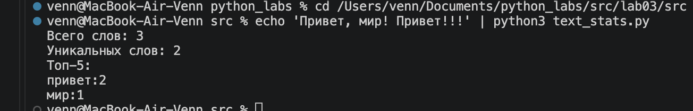

### Лабораторная работа 3

#### Задание 1


```python
import re
def normalize(text: str, *, casefold: bool = True, yo2e: bool = True) -> str:
    """Приводит текст к единому виду: регистр, ё→е, пробелы."""
    if casefold:
        text = text.casefold()
    else:
        text = text.lower()
    if yo2e:
        text = text.replace("ё", "е").replace("Ё", "Е")
    return " ".join(text.split())


def tokenize(text: str) -> list[str]:
    """Разбивает текст на слова (буквы, цифры, дефис внутри слова)."""
    pattern = r"\w+(?:-\w+)*"
    return re.findall(pattern, text)


def count_freq(tokens: list[str]) -> dict[str, int]:
    """Считает, сколько раз встретилось каждое слово."""
    freq = {}
    for word in tokens:
        freq[word] = freq.get(word, 0) + 1
    return freq


def top_n(freq: dict[str, int], n: int = 5) -> list[tuple[str, int]]:
    """Топ-N слов: по убыванию частоты, при равенстве по алфавиту."""
    return sorted(freq.items(), key=lambda p: (-p[1], p[0]))[:n]
```






#### Задание 2


```python
import sys
from lib.text import normalize, tokenize, count_freq, top_n
tokens = tokenize(normalize(sys.stdin.read()))
freq = count_freq(tokens)
print("Всего слов:", len(tokens))
print("Уникальных слов:", len(freq))
print("Топ-5:")
for word, count in top_n(freq, 5):
    print(f"{word}:{count}")
```

