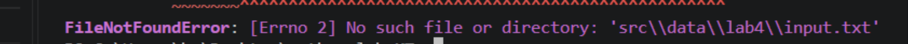
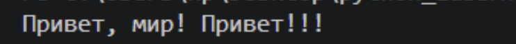
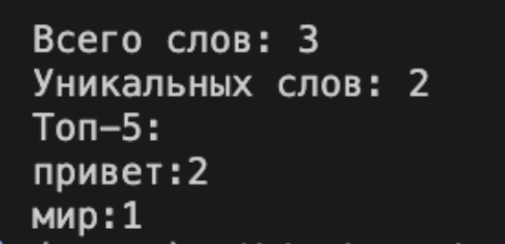
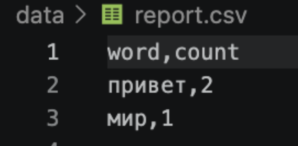
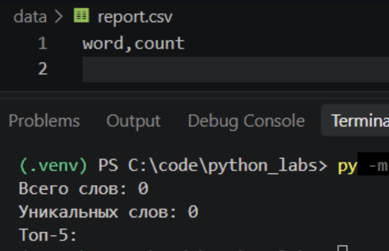
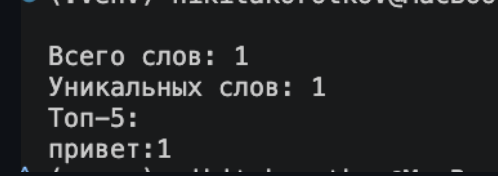

### Лабораторная работа 4

#### Задание 1

```python
import csv
from pathlib import Path


def read_text(path: str | Path, encoding: str = "utf-8") -> str:
    """Читает файл целиком и возвращает содержимое одной строкой.

    Другая кодировка выбирается параметром encoding, например:
    read_text("data/input.txt", encoding="cp1251").

    FileNotFoundError (файла нет) и UnicodeDecodeError (кодировка
    не подходит) не перехватываются, пусть падают.
    """
    return Path(path).read_text(encoding=encoding)


def write_csv(rows: list[tuple | list], path: str | Path,
              header: tuple[str, ...] | None = None) -> None:
    """Создаёт или перезаписывает CSV-файл с разделителем ','.

    Если передан header, он записывается первой строкой.
    Если строки в rows разной длины, поднимается ValueError.
    """
    rows = list(rows)
    if len({len(r) for r in rows}) > 1:
        raise ValueError("Строки в rows имеют разную длину")

    with Path(path).open("w", newline="", encoding="utf-8") as f:
        w = csv.writer(f)
        if header is not None:
            w.writerow(header)
        w.writerows(rows)
```







#### Задание 2

```python
import sys
from pathlib import Path

sys.path.insert(0, str(Path(__file__).resolve().parents[1])) 
from lib.text import normalize, tokenize, count_freq, top_n
from lab04.io_txt_csv import read_text, write_csv

try:
    text = read_text("data/input.txt")
except FileNotFoundError:
    sys.exit("Ошибка: файл data/input.txt не найден")

tokens = tokenize(normalize(text))
freq = count_freq(tokens)

write_csv(top_n(freq, len(freq)), "data/report.csv", header=("word", "count"))

print(f"Всего слов: {len(tokens)}")
print(f"Уникальных слов: {len(freq)}")
print("Топ-5:", top_n(freq, 5))
for word, count in top_n(frequencies, 5):
        print(f"{word}:{count}")
```





