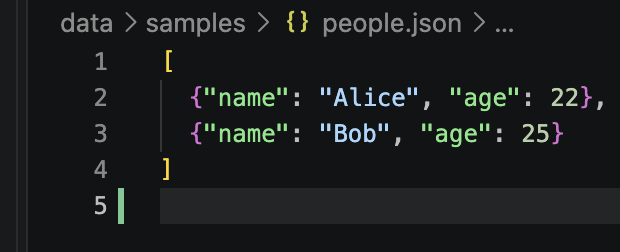
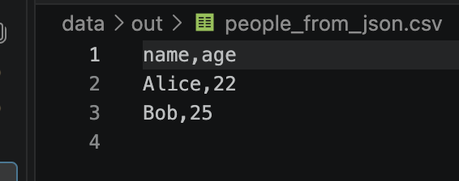
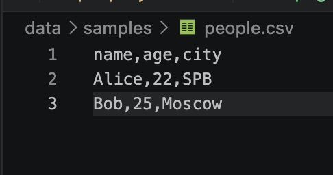
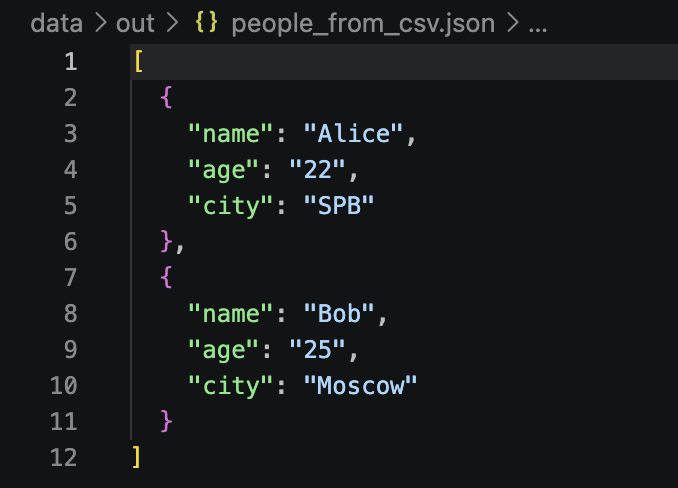
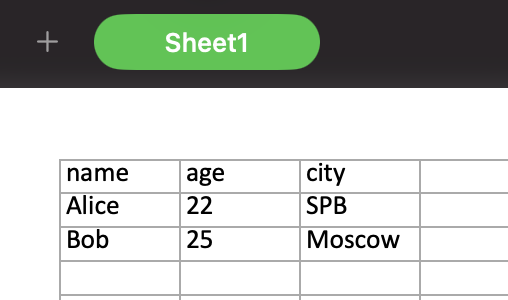
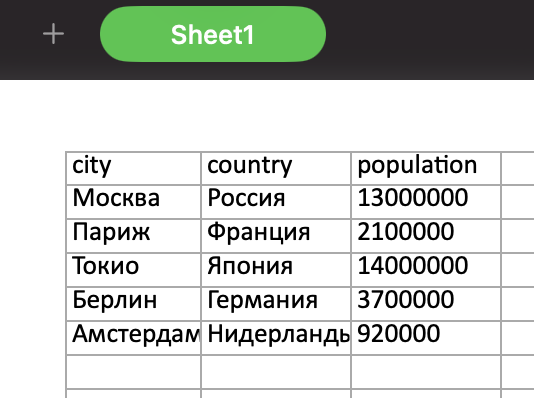

### Лабораторная работа 5

#### Задание 1

```python
import json
import csv
from pathlib import Path


def json_to_csv(json_path: str, csv_path: str) -> None:
    '''Преобразует JSON (список словарей) в CSV.'''
    if Path(json_path).suffix != ".json" or Path(csv_path).suffix != ".csv":
        raise ValueError("Неверный формат файла")

    with open(json_path, encoding="utf-8") as f:
        data = json.load(f)

    if not isinstance(data, list) or not data or not all(isinstance(x, dict) for x in data):
        raise ValueError("Некорректный JSON")

    fields = list(dict.fromkeys(key for item in data for key in item))

    if not fields:
        raise ValueError("В JSON нет полей")

    with open(csv_path, "w", newline="", encoding="utf-8") as f:
        writer = csv.DictWriter(f, fieldnames=fields)
        writer.writeheader()
        writer.writerows(data)


def csv_to_json(csv_path: str, json_path: str) -> None:
    '''Преобразует CSV в JSON (список словарей).'''
    if Path(csv_path).suffix != ".csv" or Path(json_path).suffix != ".json":
        raise ValueError("Неверный формат файла")

    with open(csv_path, encoding="utf-8", newline="") as f:
        reader = csv.DictReader(f)

        if not reader.fieldnames:
            raise ValueError("CSV пуст")

        data = list(reader)

    if not data:
        raise ValueError("CSV не содержит записей")

    with open(json_path, "w", encoding="utf-8") as f:
        json.dump(data, f, ensure_ascii=False, indent=2)
```







#### Задание 2

```python
import csv
from pathlib import Path
from openpyxl import Workbook

def csv_to_xlsx(csv_path: str, xlsx_path: str) -> None:
    '''Конвертирует CSV в XLSX: лист Sheet1, автоширина колонок.'''
    if Path(csv_path).suffix != ".csv" or Path(xlsx_path).suffix != ".xlsx":
        raise ValueError("Неверный формат файла")

    with open(csv_path, encoding="utf-8", newline="") as f:
        rows = list(csv.reader(f))

    if not rows:
        raise ValueError("CSV пуст")

    wb = Workbook()
    ws = wb.active
    ws.title = "Sheet1"

    for row in rows:
        ws.append(row)

    for col in ws.columns:
        width = max(len(str(cell.value or "")) for cell in col)
        ws.column_dim[col[0].column_letter].width = max(8, width)

    wb.save(xlsx_path)
```



