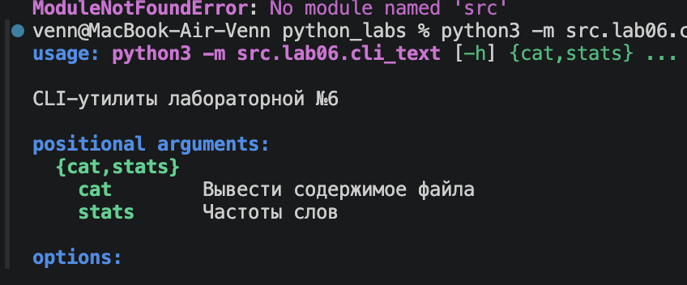
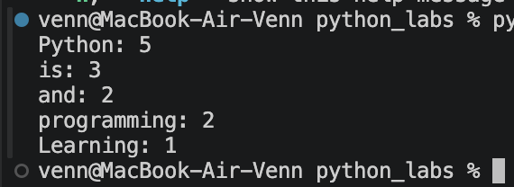
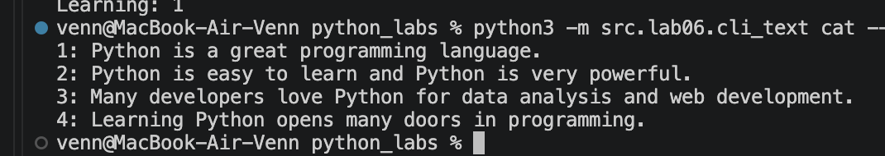
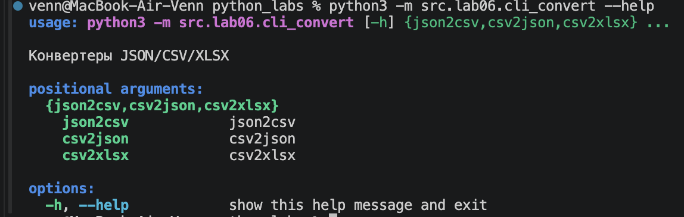
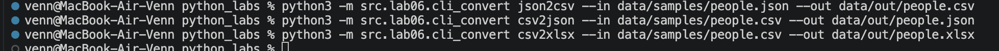

### Лабораторная работа 6

#### Задание 1

```python
import argparse, sys
from src.lib.text import tokenize, count_freq, top_n

def main():
    p = argparse.ArgumentParser(description="CLI-утилиты лабораторной №6")
    sub = p.add_subparsers(dest="command", required=True)

    c = sub.add_parser("cat", help="Вывести содержимое файла")
    c.add_argument("--input", required=True)
    c.add_argument("-n", action="store_true", help="Нумеровать строки")

    s = sub.add_parser("stats", help="Частоты слов")
    s.add_argument("--input", required=True)
    s.add_argument("--top", type=int, default=5)

    a = p.parse_args()
    try:
        with open(a.input, encoding="utf-8") as f:
            text = f.read()
    except FileNotFoundError:
        print(f"файл не найден: {a.input}", file=sys.stderr)
        sys.exit(1)

    if a.command == "cat":
        for i, line in enumerate(text.splitlines(), 1):
            print(f"{i}: {line}" if a.n else line)
    else:
        for word, count in top_n(count_freq(tokenize(text)), a.top):
            print(f"{word}: {count}")

if __name__ == "__main__":
    main()
```






#### Задание 2

```python
import argparse, sys
from src.lab05.json_csv import json_to_csv, csv_to_json
from src.lab05.csv_xlsx import csv_to_xlsx

CMDS = {"json2csv": json_to_csv, "csv2json": csv_to_json, "csv2xlsx": csv_to_xlsx}

def main():
    p = argparse.ArgumentParser(description="Конвертеры JSON/CSV/XLSX")
    sub = p.add_subparsers(dest="command", required=True)
    for name in CMDS:
        sp = sub.add_parser(name, help=name)
        sp.add_argument("--in", dest="src", required=True)
        sp.add_argument("--out", dest="dst", required=True)

    a = p.parse_args()
    try:
        CMDS[a.command](a.src, a.dst)
    except (FileNotFoundError, ValueError) as e:
        print(f"ошибка: {e}", file=sys.stderr)
        sys.exit(1)

if __name__ == "__main__":
    main()
```





